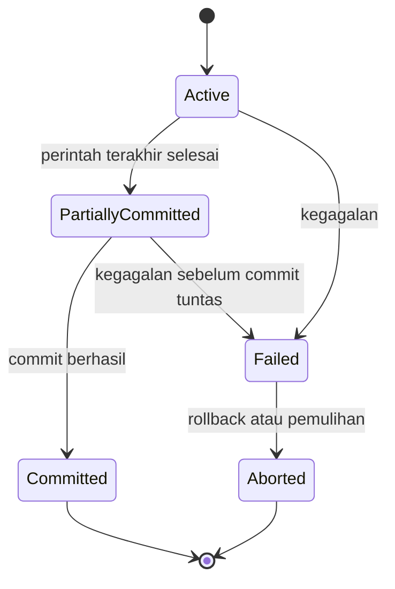

# TUWEB 03 - SQL, transaksi, dan basis data terdistribusi

**Mata kuliah:** STSI4105 - Basis Data  
**Durasi tatap muka:** 90 menit  
**Cakupan:** AB 8-11; AB 7 sebagai pengulangan prasyarat  
**Lingkungan demo:** Rancher Desktop dengan dockerd (moby), Docker Compose, MariaDB 11.4, dan terminal MariaDB. phpMyAdmin opsional.  
**Kasus:** rumah sakit dari Panduan Praktikum SQL; nama dan data contoh disusun ulang oleh tutor.

Dokumen ini memuat bahan bicara tutor, penjelasan konsep, SQL, prediksi hasil, pertanyaan, dan latihan. Baca [README](README.md) untuk persiapan. Kode siap pakai ada pada [folder SQL](sql).

## 1. Posisi materi dan sumber

### 1.1 Pemetaan sumber ke kegiatan

Nomor halaman di bawah mengikuti urutan halaman PDF, termasuk sampul.

| Sumber | Pokok materi | Perlakuan pada TUWEB 03 |
| --- | --- | --- |
| AK07_SQL dan DML_AB 7(1).pdf, hlm. 2-8 | SQL; DDL; DML; contoh pegawai | Pengulangan AB 7 untuk menghubungkan rancangan dengan praktik AB 8 |
| USA_Panduan_Prak_T2_STSI 4105 Edisi 2(1).pdf, hlm. 8-21 | DDL, akses DBMS, enam tabel rumah sakit, relasi | Lingkungan dan skema disiapkan sebelum kelas; struktur ditinjau singkat |
| Panduan Praktikum SQL yang sama, hlm. 22-36 | INSERT, SELECT, WHERE, JOIN, fungsi, BETWEEN, LIKE, ORDER BY, GROUP BY, UPDATE, DELETE | Inti praktik SQL AB 8; beberapa variasi menjadi latihan mandiri |
| AK09 - Konsep Manajemen Traksaksi_AB 9(1).pdf, hlm. 2-8 | Transaksi, ACID, status, schedule, serializability, locking, timestamp, deadlock | Inti konsep AB 9; demo transaksi dan satu konflik kunci |
| AK10_Konsep Basis Data Terdistribusi_AB 10(1).pdf, hlm. 2-4 | Definisi, alasan, replikasi, partisi horizontal/vertikal, kombinasi, strategi | Inti konsep AB 10; analisis kebutuhan dua cabang |
| RAT STSI4105 tahun 2025, hlm. 4, baris 8-11 | Praktikum SQL, transaksi, distribusi, instalasi VirtualBox | Menetapkan cakupan sesi sesuai pembagian TUWEB yang disepakati |
| USA_Panduan_Prak_T3-1_STSI 4105 Edisi 2_ AB 11.pdf, bagian pengantar, instalasi, Ubuntu, dan pengecekan koneksi | VirtualBox dan lingkungan dua mesin | Sumber tambahan dari unggahan sebelumnya untuk AB 11; bukan salah satu dari empat lampiran terbaru |

**Batas sesi:** konfigurasi replikasi aktif dan praktikum transaksi/distribusi secara penuh masuk AB 12/TUWEB 04. Demo transaksi pendek pada sesi ini membantu menjelaskan AB 9. AB 11 tetap membahas VirtualBox; Docker merupakan pilihan lingkungan SQL tutor, bukan pengganti otomatis kewajiban praktik VirtualBox pada RAT.

### 1.2 Penyesuaian yang harus dijelaskan

| Aspek sumber | Penyesuaian lab tutor | Alasan |
| --- | --- | --- |
| XAMPP dan `rumahsakit` | Service `db` dari TUWEB 02, database `tuweb02`, tabel `t3_...` | Memakai lingkungan yang sudah berjalan; memisahkan data latihan |
| Nama enam tabel rumah sakit | `t3_pasien`, `t3_dokter`, `t3_administrator`, `t3_pasien_dokter`, `t3_daftar`, `t3_dokter_admin` | Awalan hanya membedakan sesi, bukan konsep baru |
| Kode jenis kelamin angka pada contoh sumber | `L` dan `P`, mengikuti lab TUWEB 02 | Query harus mengikuti nilai yang benar-benar tersimpan |
| Contoh `INT(3)` | `INT`; batasan dinyatakan dengan PK/FK/CHECK sesuai kebutuhan | Angka display width bukan batas tiga digit |
| INDEX pada kolom hubungan | FK dinyatakan secara eksplisit dalam DDL | INDEX saja tidak menegakkan integritas referensial |
| Contoh `ON DELETE CASCADE` | `ON DELETE RESTRICT` pada data kasus | Keputusan lab untuk mempertahankan riwayat; jelaskan akibat penghapusan |
| `SELECT * ... GROUP BY jenis_kelamin` | Pilih kolom pengelompokan dan agregat secara eksplisit | Menghindari kolom yang tidak terdefinisi bagi satu kelompok; sesuai mode `ONLY_FULL_GROUP_BY` |
| Saldo, LEFT JOIN, HAVING, SAVEPOINT | Contoh tambahan tutor | Membantu menjelaskan jumlah baris, transaksi, dan hasil; bukan klaim salinan PDF |

Pengelompokan tidak menghapus baris dari tabel. `GROUP BY` membentuk kelompok untuk hasil query. Jika hanya ingin nilai unik, gunakan `DISTINCT`.

## 2. Capaian dan alur 90 menit

Setelah sesi, mahasiswa diharapkan mampu:

1. Memilih tabel, kolom, dan kondisi untuk kebutuhan informasi sederhana.
2. Menjelaskan JOIN tiga tabel dan membedakan jumlah pemeriksaan dari jumlah pasien.
3. Memakai agregasi dan menjelaskan kelompok serta penyaringan hasil agregasi.
4. Menjelaskan ACID, COMMIT, ROLLBACK, dan satu konflik akses bersamaan.
5. Membedakan replikasi, partisi horizontal, dan partisi vertikal dari contoh kebutuhan.
6. Menjelaskan peran VM dan menunjukkan bukti dasar lingkungan VirtualBox sesuai RAT.

| Menit | Durasi | Kegiatan tutor | Kegiatan mahasiswa / hasil |
| --- | --- | --- | --- |
| 00-05 | 5 | Jelaskan tujuan; periksa koneksi yang telah disiapkan | Menunjukkan database aktif dan hasil hitung awal |
| 05-12 | 7 | Ulangi DDL/DML; telusuri enam tabel dan contoh DML | Memprediksi satu perubahan data dan hasil ROLLBACK |
| 12-32 | 20 | Demo query terpilih: filter, JOIN, pasien tanpa pemeriksaan, agregasi | Menjelaskan asal setiap baris dan perbedaan COUNT |
| 32-42 | 10 | Beri latihan JOIN bersyarat dan HAVING; bahas jawaban | Menyerahkan dua query dan prediksi hasil |
| 42-60 | 18 | Jelaskan ACID dan status transaksi; demo batal/sukses | Mencatat saldo sebelum/sesudah serta alasan COMMIT/ROLLBACK |
| 60-70 | 10 | Tunjukkan konflik kunci pada dua koneksi; bahas schedule/deadlock | Menjelaskan pihak yang menunggu dan langkah membebaskan kunci |
| 70-80 | 10 | Bandingkan strategi distribusi pada dua cabang | Memilih strategi dan menyebut satu konsekuensi |
| 80-87 | 7 | Tunjukkan VM siap pakai dan pemeriksaan alamat jaringan | Membedakan VM, container, koneksi DB, dan node distribusi |
| 87-90 | 3 | Exit ticket dan arahkan pekerjaan lanjutan | Menjawab tiga pertanyaan ringkas |
| **Total** | **90** | | |

**Aturan pelaksanaan:** unduh image, inisialisasi data, dan instalasi VirtualBox/Ubuntu dilakukan sebelum sesi. Saat ada kendala perangkat, tutor tetap mendemokan hasil dan mahasiswa mengerjakan prediksi/query. Instalasi ulang tidak mengambil waktu pembahasan inti. Query referensi tambahan dan konfigurasi jaringan lengkap dikerjakan di luar 90 menit.

## 3. Persiapan sebelum kelas

### 3.1 Jalankan server yang sudah tersedia

Dari root repository, di PowerShell atau Bash:

```sh
cd STSI4105/TUWEB02
docker version
docker compose version
docker compose up -d --wait db
```

Untuk pengguna Rancher Desktop, pilih engine **dockerd (moby)**. Jika Kubernetes tidak dipakai untuk kelas, ia dapat dinonaktifkan. Jika `docker version` tidak menampilkan bagian Server, pastikan Rancher Desktop sudah siap. Panduan lengkap ada pada [LAB_DOCKER.md TUWEB 02](../TUWEB02/LAB_DOCKER.md).

Pada penggunaan pertama, salin `.env.example` menjadi `.env` dan isi dua password terlebih dahulu. Jangan menimpa `.env` yang sudah dipakai. Jika opsi `--wait` tidak tersedia, gunakan `up -d db` dan periksa `docker compose ps`.

### 3.2 Siapkan data TUWEB 03

Tetap dari folder `STSI4105/TUWEB02`:

```sh
docker compose cp ../TUWEB03/sql db:/tmp/tuweb03-sql
docker compose exec db mariadb -u mahasiswa -p tuweb02
```

Masukkan `MARIADB_PASSWORD` dari `.env`. Pada prompt MariaDB:

```sql
SOURCE /tmp/tuweb03-sql/00-siapkan-lab.sql;
SELECT VERSION(), DATABASE(), @@autocommit;
```

Skrip persiapan menghapus dan membuat ulang **hanya delapan tabel latihan bernama `t3_...` yang disebut dalam skrip**, termasuk tabel demo jika sudah ada. Jalankan sebelum kelas dan setelah seluruh koneksi latihan selesai. Hasil latihan TUWEB 03 pada tabel tersebut akan hilang. Tabel TUWEB 02 tanpa awalan `t3_` tetap ada. Jangan gunakan `down -v` untuk menyiapkan sesi ini.

Hasil awal: 3 pasien, 4 pemeriksaan, total saldo 150000.00. Setelah persiapan ada tujuh tabel `t3_`; tabel kedelapan, `t3_pasien_demo`, baru dibuat saat demo DML. Tidak perlu hak root atau database baru: akun `mahasiswa` memakai haknya pada `tuweb02`.

### 3.3 Pilih antarmuka

| Keperluan | Cara |
| --- | --- |
| Query baca | Terminal MariaDB atau phpMyAdmin |
| Demo transaksi bertahap dan dua sesi | Dua terminal MariaDB dengan koneksi terpisah |
| phpMyAdmin | Dari folder TUWEB02: `docker compose --profile gui up -d --wait`; buka http://localhost:8080 |
| Klien desktop pada komputer tutor | Host `127.0.0.1`, port `3307` atau DB_PORT, database `tuweb02` |
| Diagram untuk menelusuri JOIN | [GraphML rumah sakit](../TUWEB02/diagrams/rumahsakit.graphml) pada yEd Live; nama tabel lab kini berawalan `t3_` |

Gunakan **CLI yang tetap terbuka** untuk transaksi. Jangan menganggap dua klik pada tab SQL phpMyAdmin memakai koneksi yang sama. Jangan memasukkan password sebagai teks perintah yang direkam.

## 4. Pengulangan DDL dan DML (menit 05-12)

### 4.1 Struktur berbeda dari isi

| Kelompok | Fungsi | Contoh | Pertanyaan tutor |
| --- | --- | --- | --- |
| DDL | Mendefinisikan struktur | CREATE, ALTER, DROP, CREATE INDEX | Apakah bentuk tabel berubah? |
| DML | Membaca/mengubah isi | SELECT, INSERT, UPDATE, DELETE | Baris mana yang dibaca atau diubah? |
| Kendali transaksi | Menentukan batas satu unit pekerjaan | START TRANSACTION, COMMIT, ROLLBACK | Apakah seluruh pekerjaan diterima atau dibatalkan? |

Sumber AB 7 mengelompokkan SELECT dalam DML. Sebagian referensi menyebut DQL; istilah tersebut tidak mengubah cara menjalankan SELECT.

### 4.2 Telusuri model rumah sakit

| Tabel | Identitas / hubungan | Jumlah awal |
| --- | --- | --- |
| `t3_pasien` | PK `id_pasien`; nama, alamat, jenis kelamin | 3 |
| `t3_dokter` | PK `id_dokter`; nama, spesialis | 2 |
| `t3_administrator` | PK `id_admin`; nama, waktu jaga | 2 |
| `t3_pasien_dokter` | PK `id`; FK pasien dan dokter; tanggal, resep | 4 |
| `t3_daftar` | PK `id_daftar`; FK pasien dan administrator | 3 |
| `t3_dokter_admin` | PK `id_data`; FK dokter dan administrator | 3 |

Satu baris `t3_pasien_dokter` berarti **satu pemeriksaan**, bukan satu pasien unik. Pasien dapat diperiksa lebih dari sekali, termasuk oleh dokter yang sama. Tabel `t3_rekening` merupakan contoh tambahan untuk transaksi; ia tidak menjadi bagian ERD rumah sakit sumber.

Tinjau bentuk tabel tanpa membuat ulang tabel kasus:

```sql
SHOW CREATE TABLE t3_pasien_dokter;
DESCRIBE t3_pasien;
```

FK menolak referensi pasien/dokter yang tidak ada. Menggambar garis pada yEd Live tidak otomatis membuat FK pada MariaDB.

### 4.3 Demo INSERT, UPDATE, DELETE

Jalankan [02-dml.sql](sql/02-dml.sql) tahap demi tahap. Intinya:

```sql
START TRANSACTION;
INSERT INTO t3_pasien_demo VALUES
  (91, 'Pasien Latihan', 'Jl. Latihan 1', 'L'),
  (92, 'Pasien Uji', 'Jl. Latihan 2', 'P');
SELECT * FROM t3_pasien_demo WHERE id_pasien = 92;
UPDATE t3_pasien_demo SET nama_pasien = 'Pasien Uji Revisi'
WHERE id_pasien = 92;
DELETE FROM t3_pasien_demo WHERE id_pasien = 91;
SELECT * FROM t3_pasien_demo ORDER BY id_pasien;
ROLLBACK;
```

**Prasyarat:** jalankan CREATE TABLE pada awal berkas terlebih dahulu; potongan di atas bukan skrip persiapan lengkap. Sebelum ROLLBACK, tersisa ID 92 dengan nama baru. Setelah ROLLBACK, tabel demo kembali kosong. Tabelnya tetap ada karena CREATE TABLE dikerjakan di luar transaksi.

Sebelum UPDATE/DELETE, gunakan SELECT dengan kondisi yang sama untuk memeriksa sasaran. WHERE yang hilang dapat memengaruhi seluruh tabel. PK/FK membantu integritas, tetapi tidak mengetahui apakah tutor memilih pasien yang benar.

**Referensi DDL mandiri:** coba CREATE TABLE, ALTER TABLE ADD COLUMN, CREATE INDEX, DROP INDEX, dan DROP TABLE hanya pada tabel tambahan `t3_catatan_ddl`. DDL pada MariaDB dapat memicu implicit commit; jangan memasukkannya ke tengah demo transfer yang hendak dibatalkan. Hindari DROP DATABASE pada server bersama.

## 5. Praktik mengambil informasi (menit 12-32)

### 5.1 Cara membaca kebutuhan informasi

Sebelum menulis query, nyatakan: **satu baris hasil mewakili apa?** Kemudian tentukan kolom keluaran, tabel asal, hubungan kunci, filter, agregasi, dan urutan. Ini mencegah JOIN yang benar secara sintaks tetapi salah makna.

Untuk 20 menit, tunjukkan Q02 singkat, Q07 dan Q09, lalu Q10-Q12. Q01/Q03-Q06 tersedia sebagai referensi dan latihan mandiri. Berkas [01-query.sql](sql/01-query.sql) berisi seluruh query Q01-Q14, tetapi tidak harus dijalankan sekaligus ketika mengajar.

### 5.2 SELECT, WHERE, BETWEEN, LIKE, fungsi string, dan ORDER BY

Contoh filter pasien laki-laki (Q02):

```sql
SELECT id_pasien, nama_pasien
FROM t3_pasien
WHERE jenis_kelamin = 'L'
ORDER BY id_pasien;
```

Hasil: ID 1 dan 3. Nilai `'L'` mengikuti data lab, bukan angka `'1'` pada contoh PDF.

| Query referensi | Tujuan | Hasil data awal |
| --- | --- | --- |
| Q01 | Pilih ID dan nama; urutkan ID naik | ID 1, 2, 3 |
| Q02 | Filter `jenis_kelamin = 'L'` | ID 1, 3 |
| Q03 | `BETWEEN 1 AND 2` | ID 1, 2; kedua batas termasuk |
| Q04 | `nama_pasien LIKE '%B%'` | Pasien B |
| Q05 | LEFT, RIGHT, MID pada alamat | `Jl`; nomor 1/2/3; `Contoh` |
| Q06 | `ORDER BY id_pasien DESC` | ID 3, 2, 1 |

Bentuk fungsi string (Q05):

```sql
SELECT id_pasien,
       LEFT(alamat_pasien, 2) AS awalan,
       RIGHT(alamat_pasien, 1) AS nomor,
       MID(alamat_pasien, 5, 6) AS potongan
FROM t3_pasien
ORDER BY id_pasien;
```

`MID(teks, posisi, jumlah)` mulai pada posisi 1. Pada `Jl. Contoh 1`, posisi 5 adalah `C`. `%` pada LIKE mewakili nol atau lebih karakter; `_` mewakili satu karakter. Tanpa ORDER BY, urutan hasil tidak dijamin.

### 5.3 JOIN tiga tabel: siapa diperiksa oleh siapa?

**Kebutuhan:** tampilkan satu baris per pemeriksaan beserta pasien, tanggal, resep, dan dokter (Q07).

```sql
SELECT pd.id, p.nama_pasien, pd.waktu_periksa,
       pd.resep, d.nama_dokter
FROM t3_pasien AS p
JOIN t3_pasien_dokter AS pd ON pd.id_pasien = p.id_pasien
JOIN t3_dokter AS d ON d.id_dokter = pd.id_dokter
ORDER BY pd.id;
```

| id pemeriksaan | nama_pasien | waktu_periksa | nama_dokter |
| --- | --- | --- | --- |
| 1 | Pasien A | 2026-10-01 | Dokter A |
| 2 | Pasien A | 2026-10-02 | Dokter B |
| 3 | Pasien B | 2026-10-02 | Dokter A |
| 4 | Pasien A | 2026-10-03 | Dokter A |

Kolom resep juga tampil sesuai data awal. Jelaskan bahwa alias `p`, `pd`, dan `d` hanya singkatan tabel. Kondisi ON mengikuti PK/FK, bukan kesamaan nama orang. Tanpa kondisi hubungan yang benar, kombinasi baris dapat berlipat.

Pasien A muncul tiga kali karena mempunyai tiga pemeriksaan. Itu benar untuk grain pemeriksaan. Menambahkan DISTINCT secara otomatis dapat menyembunyikan rincian yang masih diperlukan.

### 5.4 LEFT JOIN: siapa belum pernah diperiksa?

Q07 hanya memunculkan pasangan yang cocok. Untuk mempertahankan pasien yang belum diperiksa, gunakan LEFT JOIN (Q09):

```sql
SELECT p.id_pasien, p.nama_pasien
FROM t3_pasien AS p
LEFT JOIN t3_pasien_dokter AS pd ON pd.id_pasien = p.id_pasien
WHERE pd.id IS NULL
ORDER BY p.id_pasien;
```

Hasil: **Pasien C, ID 3**. Pada baris tanpa pasangan, kolom `pd.id` bernilai NULL. Gunakan `IS NULL`, bukan `= NULL`. Menggunakan kondisi pada kolom tabel kanan di WHERE perlu diperiksa karena dapat menyingkirkan baris yang ingin dipertahankan.

### 5.5 Jumlah pasien berbeda dari jumlah pemeriksaan

```sql
SELECT COUNT(*) AS jumlah_pemeriksaan,
       COUNT(DISTINCT id_pasien) AS pasien_diperiksa
FROM t3_pasien_dokter;
```

Hasil: **4 pemeriksaan, 2 pasien pernah diperiksa**. Query `SELECT COUNT(*) FROM t3_pasien;` menghasilkan 3 pasien terdaftar.

| Pertanyaan | Ukuran | Nilai |
| --- | --- | --- |
| Berapa orang terdaftar? | COUNT baris tabel pasien | 3 |
| Berapa peristiwa pemeriksaan? | COUNT baris tabel pemeriksaan | 4 |
| Berapa orang pernah diperiksa? | COUNT DISTINCT id_pasien pada pemeriksaan | 2 |

Sebelum menghitung, jelaskan objek yang dihitung. Nama kolom keluaran harus membantu pembaca memahami ukuran tersebut.

### 5.6 GROUP BY dan COUNT pada LEFT JOIN

Hitung pemeriksaan setiap pasien, termasuk nol (Q12):

```sql
SELECT p.id_pasien, p.nama_pasien, COUNT(pd.id) AS jumlah_periksa
FROM t3_pasien AS p
LEFT JOIN t3_pasien_dokter AS pd ON pd.id_pasien = p.id_pasien
GROUP BY p.id_pasien, p.nama_pasien
ORDER BY p.id_pasien;
```

| id_pasien | nama_pasien | jumlah_periksa |
| --- | --- | --- |
| 1 | Pasien A | 3 |
| 2 | Pasien B | 1 |
| 3 | Pasien C | 0 |

**Mengapa COUNT(pd.id), bukan COUNT(*)?** LEFT JOIN tetap membentuk satu baris hasil untuk Pasien C. COUNT(*) menghitung baris itu menjadi 1; COUNT(pd.id) mengabaikan NULL sehingga hasilnya 0. Karena PK `pd.id` tidak NULL pada baris asli, ia tepat untuk menghitung pasangan pemeriksaan.

Untuk jumlah pasien per jenis kelamin (Q11):

```sql
SELECT jenis_kelamin, COUNT(*) AS jumlah_pasien
FROM t3_pasien
GROUP BY jenis_kelamin
ORDER BY jenis_kelamin;
```

Hasil L = 2, P = 1. Semua kolom nonagregat pada contoh tercantum dalam GROUP BY. `GROUP BY` berbeda dari `ORDER BY`: yang pertama membentuk kelompok, yang kedua mengurutkan hasil.

### 5.7 WHERE, HAVING, dan agregasi angka

| Unsur | Digunakan untuk | Contoh |
| --- | --- | --- |
| WHERE | Menyaring baris sebelum agregasi | Pemeriksaan dengan `id_dokter = 1` |
| GROUP BY | Menentukan satu kelompok hasil | Satu kelompok per pasien |
| HAVING | Menyaring kelompok setelah agregasi | Pasien dengan `COUNT(pd.id) >= 2` |
| SUM, MIN, MAX | Total, nilai terkecil, nilai terbesar | Saldo contoh pada Q14 |

Q13 pada latihan memakai HAVING. Q14 dapat dipelajari mandiri:

```sql
SELECT SUM(saldo) AS total_saldo,
       MIN(saldo) AS saldo_terkecil,
       MAX(saldo) AS saldo_terbesar
FROM t3_rekening;
```

Pada data awal, hasilnya 150000.00, 50000.00, dan 100000.00. Setelah demo transfer, total tetap sama tetapi MIN/MAX berubah. Sebutkan keadaan data saat membandingkan hasil.

## 6. Latihan terbimbing (menit 32-42)

Kerjakan 4 menit untuk setiap tugas, lalu 2 menit untuk membahas hasil. Mahasiswa perlu menuliskan prediksi sebelum menjalankan SQL.

### 6.1 Tugas A - JOIN dengan syarat

Tampilkan ID pemeriksaan, nama pasien, dan nama dokter untuk pemeriksaan oleh dokter ID 1. Urutkan menurut ID pemeriksaan. Apakah jumlah baris sama dengan jumlah pasien unik?

<details>
<summary>Kunci diskusi A</summary>

```sql
SELECT pd.id, p.nama_pasien, d.nama_dokter
FROM t3_pasien AS p
JOIN t3_pasien_dokter AS pd ON pd.id_pasien = p.id_pasien
JOIN t3_dokter AS d ON d.id_dokter = pd.id_dokter
WHERE d.id_dokter = 1
ORDER BY pd.id;
```

Hasil: pemeriksaan ID 1, 3, dan 4. Ada 3 pemeriksaan, tetapi hanya 2 pasien unik, yaitu Pasien A dan Pasien B.

</details>

### 6.2 Tugas B - kelompok dengan sedikitnya dua pemeriksaan

Tampilkan ID, nama pasien, dan jumlah pemeriksaan untuk pasien yang diperiksa sedikitnya dua kali.

<details>
<summary>Kunci diskusi B</summary>

```sql
SELECT p.id_pasien, p.nama_pasien, COUNT(pd.id) AS jumlah_periksa
FROM t3_pasien AS p
LEFT JOIN t3_pasien_dokter AS pd ON pd.id_pasien = p.id_pasien
GROUP BY p.id_pasien, p.nama_pasien
HAVING COUNT(pd.id) >= 2
ORDER BY p.id_pasien;
```

Hasil: Pasien A, ID 1, jumlah 3. HAVING menyaring hasil agregasi, sedangkan WHERE dipakai untuk menyaring baris sumber.

</details>

**Penilaian formatif tutor:** periksa pemilihan tabel, ON, grain hasil, syarat, dan kemampuan menjelaskan hasil. Ini bukan pengganti rubrik resmi UT.

## 7. Manajemen transaksi (menit 42-60)

### 7.1 Satu pekerjaan bisnis dapat terdiri atas beberapa perintah

Transaksi adalah satu unit pekerjaan baca/tulis yang diterima atau dibatalkan sebagai satu kesatuan. Contoh tambahan tutor: pindahkan 25000 dari rekening A ke B. Sebelum transaksi A = 100000 dan B = 50000; total = 150000. Setelah sukses A = 75000 dan B = 75000; total harus tetap 150000.

Dua UPDATE yang terpisah tanpa batas transaksi dapat meninggalkan debit tanpa kredit ketika terjadi kegagalan. DBMS tidak mengetahui sendiri bahwa dua baris tersebut merupakan transfer yang harus lengkap; aplikasi/tutor harus memberi batas transaksi dan menangani galat.

### 7.2 ACID dengan contoh

| Properti | Arti | Contoh dan batas penjelasan |
| --- | --- | --- |
| Atomicity | Semua perubahan dalam transaksi diterima atau dibatalkan | Debit dan kredit menjadi satu unit; pada kegagalan aplikasi meminta ROLLBACK |
| Consistency | Transaksi menjaga aturan/invarian yang ditetapkan | Saldo tidak negatif dan total transfer tetap; CHECK membantu saldo, tetapi total antarrekening juga perlu logika transaksi yang benar |
| Isolation | Transaksi bersamaan mengikuti aturan isolasi DBMS | Konflik akses diatur agar satu transaksi tidak merusak pekerjaan lain; detail visibilitas bergantung tingkat isolasi |
| Durability | Perubahan yang sudah di-commit dipertahankan sesuai jaminan penyimpanan DBMS | COMMIT bukan sekadar hasil SELECT; keandalan bergantung konfigurasi dan media penyimpanan |

Volume Docker mempertahankan data saat container dibuat ulang jika volumenya tetap dipakai. Volume dan backup mempunyai peran berbeda. Menunjukkan saldo setelah COMMIT hanya membuktikan hasil terlihat; itu bukan uji pemulihan setelah kegagalan daya.

### 7.3 Status transaksi

Slide AB 9 menyebut active, partially committed, failed, dan aborted. Tambahkan **committed** untuk membedakan pekerjaan yang selesai dari pekerjaan yang baru selesai menjalankan perintah terakhir.



`Partially committed` bukan berarti sebagian perubahan sudah boleh dianggap permanen. Ini istilah keadaan konseptual; bukan label yang harus tampil pada prompt MariaDB.

### 7.4 Demo ROLLBACK dan COMMIT

Gunakan [03-transaksi.sql](sql/03-transaksi.sql) pada **satu koneksi CLI**. Jalankan bagian per bagian, bukan langsung SOURCE seluruh berkas bila ingin mahasiswa mengamati keadaan antara.

| Tahap | Perintah utama | Saldo A / B yang terlihat pada sesi pelaku |
| --- | --- | --- |
| Persiapan | Reset saldo contoh di luar transaksi | 100000 / 50000 |
| Mulai | START TRANSACTION | 100000 / 50000 |
| Uji pembatalan | Debit A sebesar 25000 | 75000 / 50000 |
| Batal | ROLLBACK | 100000 / 50000 |
| Uji sukses | START TRANSACTION; debit A dan kredit B | 75000 / 75000 |
| Terima | COMMIT | 75000 / 75000; total 150000 |

Potongan inti transaksi sukses:

```sql
START TRANSACTION;
UPDATE t3_rekening SET saldo = saldo - 25000.00
WHERE id_rekening = 1 AND saldo >= 25000.00;
SELECT ROW_COUNT() AS baris_debit;
UPDATE t3_rekening SET saldo = saldo + 25000.00
WHERE id_rekening = 2;
SELECT ROW_COUNT() AS baris_kredit;
SELECT SUM(saldo) AS total_saldo FROM t3_rekening;
COMMIT;
```

**Batas contoh:** data persiapan menjamin dua rekening ada dan saldo cukup. `ROW_COUNT()` harus langsung diperiksa setelah UPDATE terkait. Jika debit/kredit tidak mengubah tepat satu baris atau muncul galat, jalankan ROLLBACK dan hentikan alur sukses. Potongan ini bukan fungsi transfer produksi: aplikasi nyata harus membuat percabangan, penanganan galat, dan kebijakan retry. Jangan meneruskan kredit ketika debit tidak berhasil.

### 7.5 Autocommit, DDL, dan SAVEPOINT

- MariaDB umumnya mengaktifkan autocommit. START TRANSACTION membentuk transaksi eksplisit sampai COMMIT/ROLLBACK.
- Galat satu statement tidak selalu membatalkan seluruh transaksi. Setelah galat pada demo, lakukan ROLLBACK secara eksplisit sebelum mengulang.
- DDL seperti CREATE/ALTER/DROP dapat menyebabkan implicit commit. ROLLBACK bukan tombol untuk mengembalikan semua jenis perintah SQL.
- SAVEPOINT memberi titik kembali di dalam transaksi, tetapi bukan pengganti penanganan deadlock. InnoDB dapat membatalkan seluruh transaksi yang dipilih sebagai korban deadlock.

Contoh SAVEPOINT **untuk mandiri**; jalankan sesudah demo sukses dan tanpa sesi lain:

```sql
START TRANSACTION;
SAVEPOINT sebelum_uji;
UPDATE t3_rekening SET saldo = saldo + 1000.00 WHERE id_rekening = 1;
ROLLBACK TO SAVEPOINT sebelum_uji;
SELECT * FROM t3_rekening ORDER BY id_rekening;
ROLLBACK;
```

Saldo tetap seperti sebelum contoh ini. Pembuatan titik simpan tidak membuat perubahan permanen.

## 8. Konkurensi dan penguncian (menit 60-70)

### 8.1 Schedule dan serializability

**Schedule** adalah urutan operasi beberapa transaksi. Urutan serial menyelesaikan satu transaksi sebelum memulai transaksi lain. Urutan berselang-seling mengizinkan operasi beberapa transaksi bercampur. **Serializability** berarti efeknya setara dengan suatu urutan serial menurut kriteria yang digunakan, bukan berarti semua operasi harus benar-benar dijalankan satu per satu.

Contoh risiko lost update: A dan B sama-sama membaca saldo 100000. A menghitung 90000 dan B menghitung 80000 dari nilai lama. Jika keduanya menulis hasil hitung tersebut tanpa perlindungan yang sesuai, salah satu perubahan dapat tertimpa. Ini ilustrasi urutan yang keliru, bukan klaim bahwa semua UPDATE InnoDB pasti menimbulkan lost update.

| Teknik pada AB 9 | Inti | Perlakuan di sesi |
| --- | --- | --- |
| Locking | Mengatur akses konflik dengan kunci | Demo kunci baris pada InnoDB |
| Timestamp | Memakai urutan waktu/logis transaksi untuk mengatur konflik sesuai algoritme | Penjelasan konsep; bukan menyimpan kolom TIMESTAMP biasa |

### 8.2 Demo dua koneksi: menunggu kunci

Buka dua PowerShell/terminal dari folder TUWEB02. Pada **masing-masing** terminal jalankan:

```sh
docker compose exec db mariadb -u mahasiswa -p tuweb02
```

Keduanya harus koneksi terpisah. Periksa `SELECT CONNECTION_ID();` dan pastikan ID berbeda. Selesaikan transaksi dari Bagian 7 terlebih dahulu.

**Persiapan di sesi A, di luar transaksi:**

```sql
SET SESSION autocommit = 1;
UPDATE t3_rekening SET saldo = CASE id_rekening
  WHEN 1 THEN 100000.00 WHEN 2 THEN 50000.00 END
WHERE id_rekening IN (1, 2);
```

| Urutan | Sesi A | Sesi B | Pengamatan |
| --- | --- | --- | --- |
| 1 | `START TRANSACTION;` | | Mulai unit kerja A |
| 2 | `SELECT * FROM t3_rekening WHERE id_rekening = 1 FOR UPDATE;` | | A memegang kunci baris rekening 1 |
| 3 | | `SET SESSION innodb_lock_wait_timeout = 5;` lalu `START TRANSACTION;` | B siap mencoba perubahan konflik |
| 4 | | `UPDATE t3_rekening SET saldo = saldo - 10000.00 WHERE id_rekening = 1;` | B menunggu; biarkan 5 detik sampai galat timeout |
| 5 | | `ROLLBACK;` | B membatalkan transaksi secara eksplisit setelah ERROR 1205 |
| 6 | `ROLLBACK;` | | A melepaskan kunci |
| 7 | `SELECT * FROM t3_rekening ORDER BY id_rekening;` | | Saldo akhir 100000 / 50000 |

Ketik setiap langkah pada sesi yang ditentukan. Jangan menjalankan semua baris A dahulu lalu semua baris B. Jika A dilepas sebelum timeout, UPDATE B bisa berhasil; lakukan ROLLBACK pada B agar latihan tidak menyimpan perubahan.

Demo ini memperlihatkan **lock wait/timeout, bukan deadlock**. Satu transaksi menunggu transaksi lain belum membentuk siklus. Pada timeout InnoDB, yang dibatalkan umumnya statement yang menunggu; karena itu demo selalu menutup transaksi B dengan ROLLBACK. Penutupan jendela, error, dan timeout tidak diperlakukan sebagai pengganti langkah kendali yang jelas.

### 8.3 Deadlock dan cara menanganinya

| Langkah konseptual | Transaksi A | Transaksi B |
| --- | --- | --- |
| 1 | Memegang kunci rekening 1 | Memegang kunci rekening 2 |
| 2 | Meminta rekening 2 dan menunggu B | Meminta rekening 1 dan menunggu A |
| Akibat | A menunggu B | B menunggu A; ada siklus |

Untuk InnoDB, deteksi deadlock dapat memilih korban dan membatalkan transaksinya; aplikasi harus menangani galat dan mengulang unit bisnis secara terkendali jika sesuai. Timeout berbeda dari deteksi siklus. Retry tidak otomatis dikerjakan oleh semua aplikasi.

Pencegahan praktis: akses rekening dengan urutan ID yang sama pada semua transaksi, jaga transaksi tetap singkat, dan jangan menahan kunci sambil menunggu interaksi manusia pada aplikasi nyata. Demo deadlock langsung merupakan pengayaan di luar sesi inti.

## 9. Basis data terdistribusi (menit 70-80)

### 9.1 Konsep dan alasan

Menurut AB 10, basis data terdistribusi merupakan satu basis data secara logis dengan data tersebar secara fisik pada beberapa lokasi yang terhubung jaringan. Beberapa database yang tidak saling dikelola sebagai satu kesatuan belum tentu memenuhi pengertian itu.

Alasan pada sumber meliputi unit bisnis tersebar, berbagi data, biaya/keandalan komunikasi, aplikasi dari beberapa vendor, recovery, dan sinkronisasi. Setiap alasan tetap memerlukan keputusan desain: distribusi tidak otomatis memperbaiki seluruh aspek.

**Kasus diskusi:** rumah sakit memiliki cabang Jakarta dan Bandung. Pasien mempunyai ID unik lintas cabang. Setiap cabang sering membaca data lokal, sementara kantor pusat memerlukan laporan gabungan. Tentukan lebih dahulu kebutuhan akses dan toleransi keterlambatan data.

### 9.2 Opsi dan contoh konkret

| Opsi pada sumber | Yang dibagi/disalin | Contoh | Penggunaan dan konsekuensi |
| --- | --- | --- | --- |
| Replikasi | Salinan data yang sama pada beberapa node | Daftar layanan tersedia di kedua cabang | Membantu baca lokal; pembaruan dan keterlambatan salinan harus dikelola |
| Partisi horizontal | Kelompok baris dengan kolom yang sama | Pemeriksaan Jakarta pada node Jakarta; pemeriksaan Bandung pada node Bandung | Mendekatkan transaksi ke cabang; laporan lintas cabang perlu penggabungan |
| Partisi vertikal | Kelompok kolom yang tetap mempunyai kunci penghubung | Data identitas dipisahkan dari kontak menggunakan `id_pasien` | Memisahkan pola akses/kolom; rekonstruksi memerlukan JOIN dan kunci yang benar |
| Kombinasi | Lebih dari satu strategi | Pemeriksaan dipartisi per cabang, daftar layanan direplikasi | Menyesuaikan beban; aturan sinkronisasi dan operasi bertambah rumit |

Contoh horizontal, **ilustrasi data, bukan tabel yang dibuat oleh skrip**:

| id_periksa | cabang | id_pasien | tanggal |
| --- | --- | --- | --- |
| 101 | Jakarta | 1 | 2026-10-01 |
| 102 | Bandung | 2 | 2026-10-02 |
| 103 | Jakarta | 3 | 2026-10-03 |

Fragmen Jakarta berisi 101/103; Bandung berisi 102. Untuk pembagian yang tidak tumpang tindih dan lengkap, seluruh baris dapat direkonstruksi dengan UNION ALL. Perpindahan cabang dan ID global harus memiliki aturan.

Contoh vertikal: `Identitas(id_pasien, nama)` dan `Kontak(id_pasien, alamat)`. Kedua fragmen menyertakan `id_pasien`. Untuk mengembalikan satu baris pasien, hubungkan berdasarkan ID dan pastikan aturan satu-ke-satu/kelengkapan yang dibutuhkan. Mengambil sembarang kolom tanpa kunci dapat menghilangkan kemampuan rekonstruksi.

**Dua perbedaan penting:** partisi tabel pada satu server belum berarti distribusi lintas node; memisahkan tabel untuk normalisasi juga belum otomatis menjadi partisi vertikal terdistribusi. Lokasi fisik dan pengelolaan lintas node perlu dinyatakan.

### 9.3 Membaca strategi pada slide AB 10 halaman 4

Tabel pada slide membandingkan reliability, expandability, communications overhead, manageability, dan data consistency. Gunakan sebagai pembuka diskusi, bukan angka jaminan setiap produk.

| Strategi yang tercantum pada slide | Inti penjelasan tutor | Pertanyaan analisis |
| --- | --- | --- |
| Centralized | Data utama terpusat | Apa dampak ketika server atau jalur pusat terganggu? |
| Replicated with snapshots | Salinan diperbarui pada titik tertentu | Berapa lama data boleh tertinggal? |
| Synchronized replication | Pembaruan antarsalinan dikoordinasikan | Apa biaya koordinasi dan dampak koneksi lambat? |
| Integrated partitions | Fragmen tersebar tetapi diakses sebagai satu kesatuan | Bagaimana query dan perubahan lintas fragmen dijalankan? |
| Decentralized with independent partitions | Unit lokal lebih mandiri | Bagaimana laporan lintas unit memperoleh arti dan data yang konsisten? |

Kualitas strategi bergantung pada desain, beban, kegagalan yang dipertimbangkan, dan implementasi. Salinan yang ikut menerima penghapusan salah bukan pengganti backup historis. Istilah sinkron/asinkron perlu dijelaskan saat membahas kapan salinan dianggap mutakhir; rincian konfigurasi masuk TUWEB 04.

### 9.4 Diskusi tiga menit di dalam blok 10 menit

Tanya: “Kedua cabang membutuhkan daftar layanan yang sama; transaksi pemeriksaan dominan lokal; laporan pusat boleh tertinggal 10 menit. Strategi apa yang masuk akal?”

**Arah jawaban:** replikasi daftar layanan, partisi horizontal pemeriksaan per cabang, dan mekanisme konsolidasi terjadwal untuk laporan. Jelaskan toleransi keterlambatan, ID global, serta penanganan pasien lintas cabang. Tidak ada satu strategi terbaik tanpa kebutuhan yang jelas. Angka 10 menit merupakan asumsi kasus tutor, bukan ketentuan RAT.

## 10. Virtualisasi dan AB 11 (menit 80-87)

### 10.1 Peran alat

| Istilah/alat | Peran | Contoh dalam tutorial |
| --- | --- | --- |
| Host | Komputer/sistem utama tempat alat berjalan | Laptop Windows tutor |
| VM | Mesin virtual dengan sistem operasi guest | Ubuntu dalam VirtualBox |
| VirtualBox | Perangkat lunak untuk membuat dan menjalankan VM | Lingkungan praktik AB 11 sesuai panduan UT |
| Container | Lingkungan proses terisolasi yang memakai kernel lingkungan host-nya | Proses MariaDB dalam service `db`; pada desktop dapat berjalan melalui VM/WSL |
| Rancher Desktop | Menyediakan lingkungan container dan pilihan Kubernetes lokal | Menjalankan Compose dengan engine dockerd (moby) |
| Node basis data | Instance server basis data yang berpartisipasi dalam arsitektur | Dua instance dapat dipakai untuk simulasi distribusi |

Dua terminal menuju service `db` adalah **dua koneksi ke satu server**, bukan dua node terdistribusi. Dua container pada satu laptop dapat menyimulasikan beberapa instance, tetapi tidak membuktikan ketahanan ketika laptop fisik gagal.

### 10.2 Demo singkat yang dipersiapkan tutor

1. Tunjukkan VirtualBox Manager dan VM Ubuntu yang sudah dipasang.
2. Tunjukkan pengaturan RAM, disk virtual, dan adapter jaringan. Sesuaikan kapasitas dengan perangkat; disk virtual adalah sasaran instalasi guest.
3. Jalankan guest dan tunjukkan bahwa ia mempunyai sistem operasi serta alamat IP sendiri.
4. Pada host Windows gunakan `ipconfig`; pada guest Linux gunakan `ip addr`.
5. Catat IP yang benar pada perangkat tersebut. Jika memakai jaringan host-only, gunakan alamat antarmuka host-only yang sesuai; NAT saja tidak otomatis memberi akses dua arah seperti contoh panduan.
6. Uji koneksi pada lingkungan yang sudah dikonfigurasi. Contoh: dari guest `ping -c 3 <IP-host>`; dari Windows `ping <IP-guest>` dengan IP nyata menggantikan placeholder.
7. Bedakan hasil ping dengan kesiapan MariaDB: respons ICMP membuktikan jalur ICMP, bukan akun, port, atau replikasi DB yang sudah benar.

**Checkpoint AB 11:** VM tercatat, guest berjalan, mode jaringan diketahui, IP dicatat, dan hasil pemeriksaan koneksi dijelaskan. Instalasi VirtualBox/Ubuntu dari awal serta konfigurasi detail dilakukan sebelum atau setelah sesi dengan panduan praktik UT. Bukti pengenalan di kelas tidak sama dengan menyelesaikan seluruh tugas instalasi.

Jika mengikuti panduan lama, sesuaikan nama menu dan pilihan instalasi dengan versi yang dipakai. Untuk kendala koneksi, periksa adapter, alamat, rute, dan aturan firewall yang relevan. Tidak perlu mematikan seluruh firewall untuk melakukan pemeriksaan terbatas. Pada Windows dengan Rancher Desktop/WSL dan VirtualBox, uji lingkungan terlebih dahulu; perilaku virtualisasi bergantung versi dan konfigurasi host.

## 11. Penutup, tindak lanjut, dan pelaporan

### 11.1 Exit ticket (menit 87-90)

| Pertanyaan | Arah jawaban |
| --- | --- |
| Mengapa COUNT(*) hasil LEFT JOIN dapat memberi 1 untuk pasien tanpa pemeriksaan? | Baris pasien tetap ada; hitung PK tabel pemeriksaan untuk menghitung pasangan yang nyata |
| Kapan transfer boleh di-COMMIT? | Setelah debit dan kredit berhasil serta aturan hasil diperiksa; jika gagal, batalkan unit transaksi |
| Apa beda dua koneksi, dua node, dan dua lokasi fisik? | Koneksi adalah sesi; node adalah instance; lokasi fisik adalah domain penempatan/kegagalan yang berbeda |

### 11.2 Latihan mandiri

1. Jalankan Q01-Q14 dan catat tujuan, query, serta hasilnya.
2. Jalankan demo DML; jelaskan mengapa baris hilang setelah ROLLBACK tetapi tabelnya tetap ada.
3. Tunjukkan transfer batal dan sukses pada CLI; catat saldo serta total.
4. Reproduksi lock wait dengan dua koneksi; catat ERROR 1205 dan lakukan ROLLBACK pada kedua sesi.
5. Pilih strategi distribusi untuk kasus dua cabang serta tulis satu keuntungan dan satu beban operasional.
6. Selesaikan praktik VirtualBox/Ubuntu dan bukti jaringan sesuai instruksi resmi kelas.

Demo SQL tambahan merupakan latihan pendamping. Tutor menetapkan pengumpulan resmi sesuai kelas, bukan menganggap semua latihan ini wajib dinilai UT.

### 11.3 Bukti dan laporan praktik

Panduan Praktikum SQL hlm. 38 meminta **tautan rekaman video** yang menampilkan perkenalan identitas, langkah praktik beserta aktivitas mahasiswa, hasil, dan penutup. Panduan AB 11 sebelumnya memakai pola pelaporan serupa. Ikuti juga ketentuan kelas tentang unggahan dan akses tautan.

Untuk membantu penjelasan, catat perintah dan hasil berikut: database aktif, JOIN beserta grain hasil, agregasi, perubahan DML, dan bukti VM untuk tugas yang relevan. Jangan mengubah daftar ini menjadi rubrik resmi baru. Semua nama pada lab bersifat fiktif; jangan merekam password `.env`.

### 11.4 Persiapan menuju TUWEB 04

TUWEB 04 meliputi AB 12-15 sesuai pembagian sesi: praktik transaksi/distribusi, aplikasi basis data, dasar pengembangan, dan pembangunan aplikasi. Siapkan lingkungan node/jaringan yang dipersyaratkan serta catatan koneksi. Replikasi tidak diaktifkan oleh skrip TUWEB 03 ini.

## 12. Kendala umum dan rujukan

### 12.1 Pemeriksaan cepat

| Gejala | Pemeriksaan/tindakan |
| --- | --- |
| Tabel `t3_pasien` tidak ada | Periksa `SELECT DATABASE();`, lalu jalankan skrip 00 pada database `tuweb02` |
| Hasil hitung berbeda | Periksa apakah data latihan telah diubah; persiapkan ulang hanya setelah semua sesi selesai dan hasil yang perlu disimpan telah dicatat |
| Skrip yang disalin masih versi lama | Jalankan ulang `docker compose cp ../TUWEB03/sql db:/tmp/tuweb03-sql` dari TUWEB02 |
| Galat GROUP BY | Pastikan kolom nonagregat contoh tercantum dalam GROUP BY; jangan menonaktifkan mode validasi untuk menghindari penjelasan |
| Saldo tidak kembali | Periksa koneksi, batas transaksi, autocommit, dan apakah ada DDL/COMMIT sebelum ROLLBACK |
| UPDATE menunggu | Periksa sesi A yang menahan kunci; selesaikan transaksi pada kedua sesi |
| Galat FK saat DELETE pasien | Pasien masih dirujuk; RESTRICT merupakan aturan lab, bukan kerusakan server |
| phpMyAdmin berhasil, aplikasi desktop gagal | Bedakan host/port: `db:3306` di jaringan Compose dan `127.0.0.1:3307` dari host |
| Ping gagal | Periksa adapter, IP, rute, dan aturan ICMP; kegagalan ping saja belum menentukan penyebab |

### 12.2 Rujukan teknis tambahan

Sumber UT pada Bagian 1 menjadi acuan cakupan. Rujukan berikut dipakai untuk memperjelas perilaku implementasi:

- [MariaDB: START TRANSACTION](https://mariadb.com/docs/server/reference/sql-statements/transactions/start-transaction).
- [MariaDB: SQL statements causing an implicit commit](https://mariadb.com/docs/server/reference/sql-statements/transactions/sql-statements-that-cause-an-implicit-commit).
- [MariaDB: InnoDB system variables](https://mariadb.com/docs/server/server-usage/storage-engines/innodb/innodb-system-variables), terutama `innodb_lock_wait_timeout` dan `innodb_rollback_on_timeout`.
- [MariaDB: GROUP BY](https://mariadb.com/docs/server/reference/sql-statements/data-manipulation/selecting-data/group-by).
- [Rancher Desktop: introduction](https://docs.rancherdesktop.io/), pilihan engine Docker CLI dan nerdctl.
- [Oracle VirtualBox: user manual](https://www.virtualbox.org/manual/), pengantar VM dan jaringan.

Materi adalah panduan tutor yang disusun ulang, bukan pengganti BMP, RAT, atau instruksi tugas. PDF sumber dan tangkapan layar sumber tidak disalin ke repository. Status pemeriksaan teknis dan batas pengujian dicatat pada [VERIFIKASI.md](VERIFIKASI.md).
