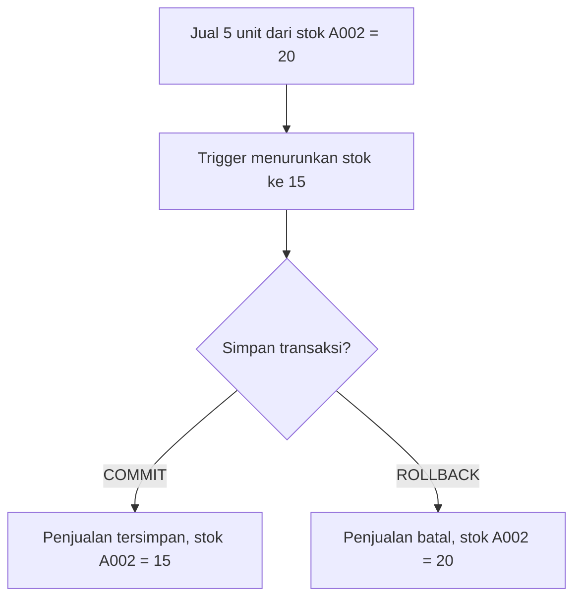
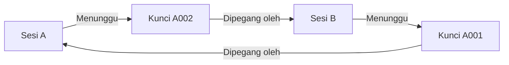
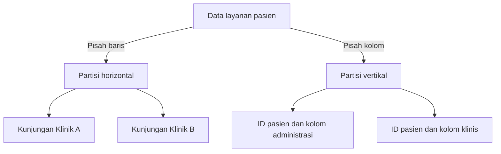
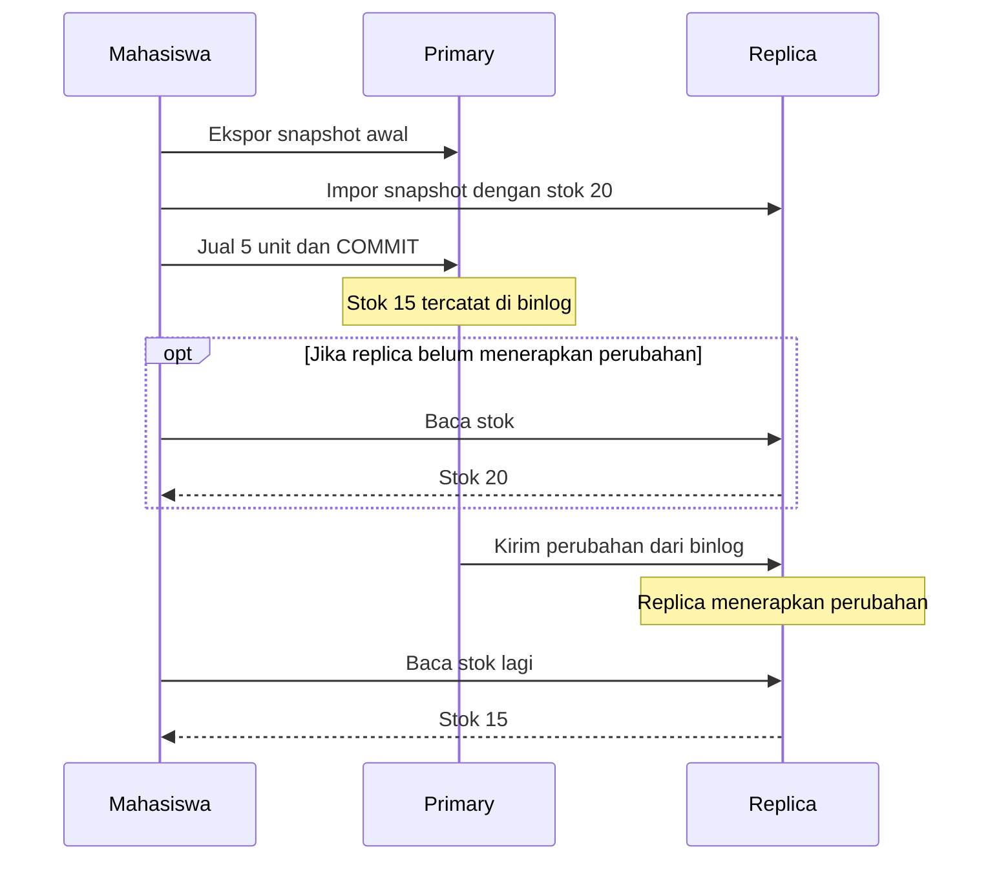
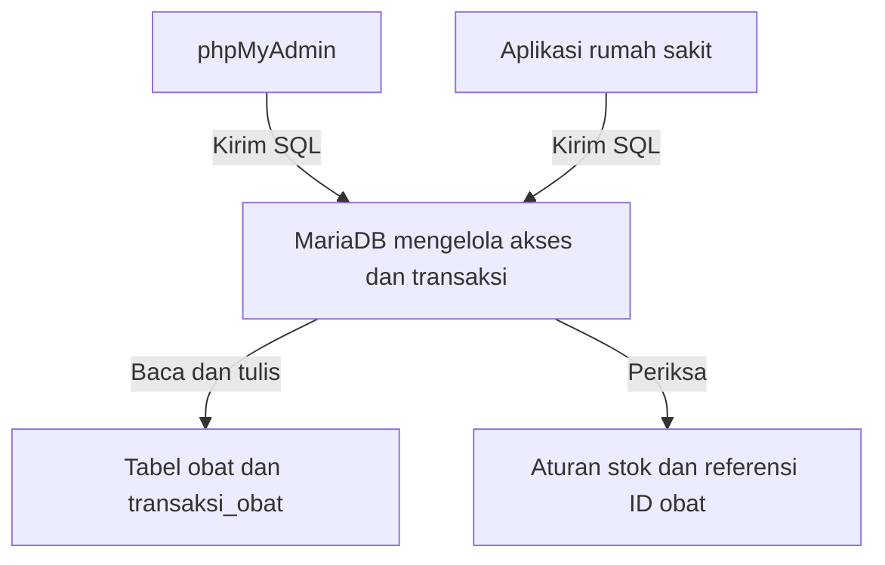
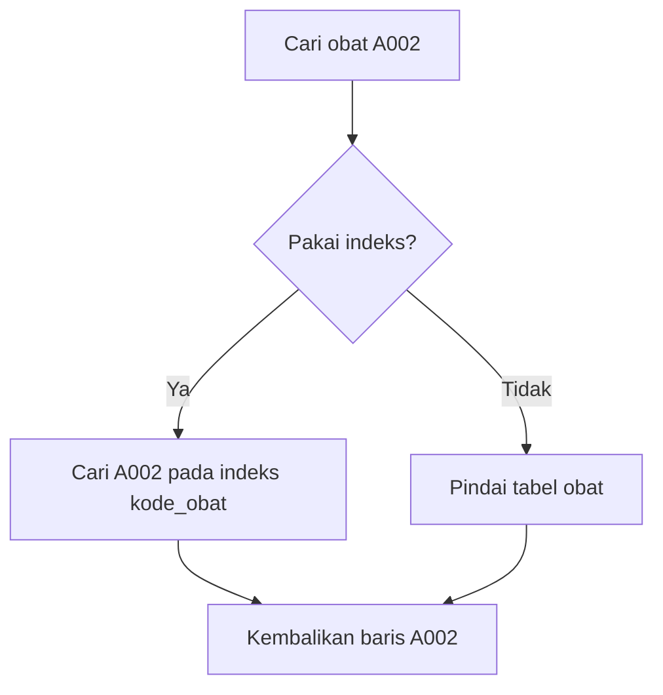
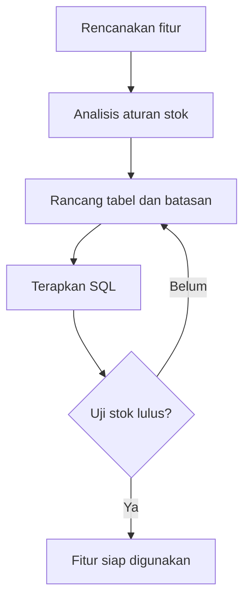

# TUWEB 04 — Praktikum Transaksi dan Basis Data Terdistribusi

**Mata kuliah** Basis Data · **Durasi** 90 menit · **Cakupan** AB 12–15

Tugas 3 mencakup **praktikum transaksi** dan **praktikum basis data terdistribusi**. Pada sesi ini Anda menguji perubahan data pasien dan stok obat, lalu membuktikan bahwa perubahan baru pada primary muncul pada replica.

Panduan UT memakai Windows, Ubuntu di VirtualBox, dan XAMPP. Di lab Docker ini, `primary` mewakili komputer 1 dan `replica` mewakili komputer 2. Keduanya memiliki proses MariaDB, ID server, dan volume masing-masing. Keduanya berjalan di satu komputer. Gunakan jalur VirtualBox dalam panduan UT jika kelas Anda mewajibkan bukti penggunaan VM atau jaringan antarkomputer. AB 13–15 dibahas dalam tutorial. Instruksi Tugas 3 mencantumkan dua praktik pada AB 12.

## 1. Alur tutorial

| Menit | Aktivitas mahasiswa |
| --- | --- |
| 0–15 | Ikuti [pengantar sebelum praktikum](#pengantar-sebelum-praktikum). Prediksi hasil transaksi dan replikasi. |
| 15–22 | Periksa tiga layanan, pilih server di phpMyAdmin, lalu cek tabel InnoDB. |
| 22–42 | Jalankan `transaksi1` sampai `transaksi5`. Bandingkan hasil sebelum dan sesudah transaksi. |
| 42–52 | Buat trigger penjualan obat dan buktikan stok berkurang dari 20 menjadi 15. |
| 52–77 | Ekspor data primary, impor ke replica, hubungkan replikasi, lalu uji satu perubahan baru. |
| 77–84 | Terapkan konsep DBMS dan akses data pada rancangan aplikasi perpustakaan. |
| 84–90 | Periksa bukti Tugas 3, susun urutan video, dan selesaikan tanya jawab. |

Pasang Rancher Desktop dan unduh image sebelum kelas. Jika waktu praktik habis, selesaikan pengujian dan rekam video secara mandiri.

## Pengantar sebelum praktikum

Gunakan kasus yang sama dengan lab. Seorang pasien membeli **5 unit A002**. Stok awal adalah **20**. Klinik lain membaca salinan data rumah sakit. Minta mahasiswa memprediksi apa yang terjadi pada transaksi penjualan, stok, dan salinan sebelum membuka terminal.

| Menit | Materi | Kegiatan |
| --- | --- | --- |
| 0–4 | AB 9 — Transaksi dan ACID | Prediksi stok jika penjualan disimpan atau dibatalkan. |
| 4–8 | AB 10 — Basis data terdistribusi | Pilih antara menyalin data dan membaginya antarlokasi. |
| 8–11 | AB 13 — DBMS dan aplikasi | Tentukan peran MariaDB, phpMyAdmin, dan aplikasi rumah sakit. |
| 11–15 | AB 14 — Penyimpanan, akses, dan pengembangan | Ikuti alur pencarian kode obat dan hubungkan satu aturan bisnis ke rancangan basis data. |

Untuk **10 menit**, gunakan pembagian **3 + 3 + 2 + 2 menit** dan alihkan sisa waktu ke praktik. Untuk **20 menit**, minta mahasiswa berpasangan selama 5 menit untuk membandingkan dua skenario di akhir pengantar. Jalankan dan periksa layanan sebelum kelas. Gunakan menit 20–22 untuk membuka phpMyAdmin dan cek tabel InnoDB.

Untuk pengantar singkat, tampilkan diagram hasil transaksi, alur replikasi, peran DBMS, dan pencarian obat. Gunakan diagram deadlock, partisi, dan pengembangan aplikasi untuk diskusi lanjutan.

### AB 9 — Apa yang terjadi jika penjualan gagal?

Transaksi mengelompokkan operasi baca dan tulis. Di lab, `INSERT` ke `transaksi_obat` memicu perubahan `obat.stok`. Gunakan empat sifat **ACID** untuk membaca hasilnya.

| Sifat | Makna pada contoh penjualan |
| --- | --- |
| **Atomicity** — atomisitas | Jika transaksi dibatalkan, baris penjualan dan perubahan stok sama-sama dibatalkan. |
| **Consistency** — konsistensi | Transaksi harus memenuhi aturan data, misalnya stok minimal nol dan ID obat merujuk ke obat yang ada. |
| **Isolation** — isolasi | Pada pengaturan lab, sesi lain belum melihat baris penjualan yang belum disimpan. |
| **Durability** — ketahanan | Perubahan yang sudah di-`COMMIT` bertahan setelah MariaDB dimulai ulang. |

`START TRANSACTION` membuka transaksi. Setelah operasi terakhir selesai, transaksi masih perlu `COMMIT` untuk menyimpan hasil. Jika operasi gagal, aplikasi dapat menjalankan `ROLLBACK` untuk membatalkan transaksi. `SAVEPOINT` memberi titik untuk membatalkan sebagian langkah.

**Hasil transaksi.** Ikuti kedua jalur dari perubahan yang sama. Baris penjualan dan stok berubah bersama.



Satu sesi dapat menunggu jika sesi lain memegang kunci pada baris obat yang ingin diubah. **Deadlock** terjadi jika terbentuk siklus tunggu.

**Siklus deadlock.** Ikuti panah dari sesi A sampai kembali ke sesi A.



**Cek cepat.** Jika stok sempat menjadi 15 di dalam transaksi lalu transaksi dibatalkan, berapa stok setelahnya? **Jawaban.** kembali ke 20.

### AB 10 — Apa yang disalin ke klinik lain?

Organisasi dapat membagi atau menyalin data ke beberapa lokasi yang terhubung lewat jaringan. Pilihan bergantung pada kebutuhan berbagi data, biaya komunikasi, dan toleransi terhadap keterlambatan.

| Strategi | Contoh pada kasus rumah sakit |
| --- | --- |
| Terpusat | Semua klinik mengakses satu server rumah sakit. |
| Replikasi | Klinik membaca salinan katalog obat dari server lain. |
| Partisi horizontal | Setiap klinik menyimpan baris kunjungan untuk lokasinya. |
| Partisi vertikal | Kolom administrasi dan kolom klinis disimpan terpisah dengan ID pasien sebagai penghubung. |
| Kombinasi | Kunjungan dipisah per klinik dan katalog obat disalin ke semua klinik. |

**Cara membaca partisi.** Pada partisi horizontal, kolomnya sama dan barisnya berbeda. Pada partisi vertikal, kedua bagian menyertakan ID pasien agar kolomnya dapat digabung kembali.



Lab memakai **replikasi satu arah**. Impor snapshot menyalin kondisi awal. Setelah itu, replica mengikuti perubahan dari primary melalui binary log. Replica dapat tertinggal sejenak. Kedua server berada dalam container terpisah pada satu komputer.

**Alur replikasi.** Garis dari atas ke bawah menunjukkan urutan kejadian. Amati kapan pembaca di replica melihat stok baru.



**Cek cepat.** Jika A005 sudah ada setelah impor snapshot, bagaimana cara membuktikan replikasi aktif? **Jawaban.** buat perubahan baru di primary, lalu periksa apakah perubahan muncul di replica.

### AB 13 — Siapa yang mengelola data?

**MariaDB** adalah DBMS. Ia menyimpan data, memeriksa hak akses dan batasan tabel, serta mengelola transaksi. **phpMyAdmin** adalah antarmuka administrasi untuk mengirim SQL dan melihat hasil. **Aplikasi rumah sakit** dapat memakai DBMS yang sama untuk formulir penjualan dan laporan stok. MySQL, PostgreSQL, SQL Server, dan Oracle Database adalah contoh DBMS lain dalam materi.

**Peran DBMS.** Antarmuka dapat berbeda. MariaDB menjalankan permintaan dan menegakkan aturan yang sama.



**Cek cepat.** Saat pengguna mencoba menyimpan stok negatif, komponen mana yang menegakkan aturan `CHECK (stok >= 0)`? **Jawaban.** MariaDB.

### AB 14 — Bagaimana aplikasi menemukan satu obat?

Saat petugas mencari `A002`, aplikasi mengirim query. DBMS memeriksa struktur tabel dan memilih cara mencari baris. Indeks pada `kode_obat` dapat membantu pencarian. DBMS mengembalikan hasil ke aplikasi. Di lab, volume Docker menjadi tempat penyimpanan data MariaDB.

**Jalur pencarian.** Kedua jalur menghasilkan baris yang sama. DBMS memilih jalur akses.



Hubungkan alur tersebut ke lima tahap pengembangan. Rencanakan fitur penjualan. Analisis aturan stok. Rancang tabel dan batasannya. Terapkan SQL. Evaluasi hasilnya dengan uji penjualan 5 unit dan uji penjualan yang melebihi stok.

**Umpan balik dari pengujian.** Jika sistem menerima penjualan yang melebihi stok, perbaiki batasan tabel dan uji kembali.



**Diskusi tambahan untuk versi 20 menit.** Bandingkan dua skenario. Pada skenario A, penjualan 5 unit dibatalkan. Pada skenario B, penjualan disimpan, tetapi replica masih menunjukkan stok 20. Jelaskan penyebabnya. **Jawaban.** A membatalkan perubahan dan stok primary kembali ke 20. Pada B, primary sudah menyimpan stok 15 dan replica belum menerapkan perubahan.

Lanjutkan ke [persiapan lab](#2-siapkan-lab-di-windows-dan-rancher-desktop). Gunakan prediksi tadi untuk memeriksa hasil praktik.

## 2. Siapkan lab di Windows dan Rancher Desktop

Di pengaturan Rancher Desktop, pilih engine **dockerd (moby)**. Tunggu sampai Rancher Desktop siap. Di PowerShell, periksa bahwa `docker version` menampilkan bagian **Client** dan **Server**.

Jika Anda belum memiliki salinan repositori, jalankan:

```powershell
git clone https://github.com/hani-ramadhan/teaching-UT.git
cd teaching-UT
```

Jika sudah memiliki salinan, buka folder repositori dan ambil versi terbaru dari branch `main`. Dari root repositori, jalankan:

```powershell
cd STSI4105\TUWEB04
docker version
docker compose version
if (-not (Test-Path .env)) { Copy-Item .env.example .env }
notepad .env
```

Ganti kedua sandi contoh dengan sandi khusus lab. Gunakan huruf dan angka agar mudah disalin ke `.env`. Simpan `.env` sebelum melanjutkan. Lalu jalankan:

```powershell
docker compose pull
docker compose up -d --wait
docker compose ps -a
```

| Layanan | Akses | Peran |
| --- | --- | --- |
| `primary` | Di jaringan Compose, `primary:3306` | Tempat mengubah data. ID server `1`. |
| `replica` | Di jaringan Compose, `replica:3306` | Tempat membaca salinan. ID server `2`. |
| `phpmyadmin` | [http://127.0.0.1:8082](http://127.0.0.1:8082) | Satu antarmuka web untuk memilih salah satu server. |

Kedua server MariaDB harus berstatus `healthy`. Pada browser, pilih **1 - Primary** dan masuk sebagai `mahasiswa` dengan nilai `MARIADB_PASSWORD` dari `.env`. Pilih basis data `rumahsakit`. Pada tab **SQL**, jalankan:

```sql
SELECT @@server_id AS server_id, @@read_only AS read_only;
SELECT table_name, engine
FROM information_schema.tables
WHERE table_schema = 'rumahsakit'
ORDER BY table_name;
```

### 2.1 Siapkan tabel dan data awal

Gunakan hasil kueri di atas untuk memilih langkah berikut.

| Hasil | Tindakan |
| --- | --- |
| `server_id=2`, `read_only=1` | Anda berada di **2 - Replica**. Tabel di sini masih kosong sebelum impor snapshot pada bagian 4. Pindah ke **1 - Primary**. |
| `server_id=1`, `read_only=0`, tiga tabel InnoDB tampil | Langsung periksa data awal. |
| `server_id=1`, `read_only=0`, tabel kosong atau belum lengkap | Impor skrip prasyarat secara manual pada **1 - Primary**. |

Untuk impor manual, simpan [`00-rumahsakit.sql`](sql/00-rumahsakit.sql). Pada phpMyAdmin, pilih **1 - Primary**, lalu buka tab **Import**, pilih berkas SQL, dan klik **Import**. Anda juga dapat menyalin isi berkas ke tab **SQL** lalu menjalankannya. Skrip membuat basis data `rumahsakit` dan tiga tabel yang diperlukan. Skrip dapat diimpor kembali untuk melengkapi data contoh. Baris yang sudah ada tetap dipertahankan.

Setelah impor, jalankan kembali pemeriksaan tabel. Ketiga tabel harus memakai InnoDB. Periksa juga data awal sebelum melanjutkan.

```sql
SELECT 'pasien' AS tabel, COUNT(*) AS jumlah FROM rumahsakit.pasien
UNION ALL SELECT 'obat', COUNT(*) FROM rumahsakit.obat
UNION ALL SELECT 'transaksi_obat', COUNT(*) FROM rumahsakit.transaksi_obat;

SELECT id_obat, kode_obat, harga, stok
FROM rumahsakit.obat WHERE kode_obat = 'A002';
```

Pada lab baru, hasilnya **3 pasien, 3 obat, dan 0 transaksi obat**. Obat `A002` memiliki **ID 2, harga 15.000, dan stok 20**. Impor ulang jika baris contoh belum terisi. Jika `A002` memakai ID selain 2, periksa data sebelum menjalankan demo trigger yang memakai ID 2. Jika stok berubah karena demo sebelumnya, gunakan blok pemulihan data contoh pada [bagian 7](#7-jika-ada-masalah) sebelum mengulang demo. Prosedur transaksi dan trigger dibuat pada bagian 3.

## 3. Praktik transaksi pada primary

Gunakan terminal untuk langkah yang memerlukan koneksi tetap. Di PowerShell, jalankan perintah berikut untuk membuka **terminal A**. Masukkan sandi mahasiswa saat diminta.

```powershell
docker compose exec primary mariadb -u mahasiswa -p rumahsakit
```

Pada prompt MariaDB di terminal A, muat [definisi prosedur](sql/01-routines.sql). Buka berkas tersebut untuk melihat kapan setiap transaksi dimulai dan berakhir.

```sql
SOURCE /lab/01-routines.sql;
SHOW PROCEDURE STATUS WHERE Db = 'rumahsakit';
```

### 3.1 Uji perubahan sebelum dan sesudah COMMIT

1. Jalankan blok berikut di terminal A. ID `101` muncul karena koneksi A dapat membaca perubahan yang dibuatnya sendiri.

   ```sql
   CALL transaksi1();
   SELECT id_pasien, nama_pasien FROM pasien WHERE id_pasien = 101;
   ```

2. Biarkan A terbuka. Buka **terminal B** dari folder yang sama dan masuk dengan perintah PowerShell yang sama. Jalankan query `SELECT` tadi pada B. Hasilnya kosong karena perubahan A belum tersimpan secara permanen.
3. Kembali ke A. Batalkan transaksi pertama, lalu jalankan prosedur yang menyimpan perubahan.

   ```sql
   ROLLBACK;
   CALL transaksi2();
   ```

4. Jalankan kembali query `SELECT` di B. Sekarang ID `101` muncul. Ambil bukti sebelum dan sesudah `COMMIT`.

`START TRANSACTION` membuka transaksi secara eksplisit. Dengan pengaturan bawaan `autocommit=1`, perintah DML yang berjalan di luar transaksi eksplisit langsung disimpan jika berhasil. Membuka blok prosedur dengan `BEGIN … END` berfungsi mengelompokkan isi prosedur.

### 3.2 Uji ROLLBACK penuh dan SAVEPOINT

Jalankan blok berikut di A secara berurutan. Catat hasil sebelum pindah ke blok berikutnya.

```sql
CALL transaksi3();
SELECT id_pasien, nama_pasien FROM pasien WHERE id_pasien = 3;

CALL transaksi4();
SELECT id_pasien, nama_pasien
FROM pasien WHERE id_pasien IN (3, 102) ORDER BY id_pasien;

CALL transaksi5();
SELECT id_pasien, nama_pasien
FROM pasien WHERE id_pasien BETWEEN 103 AND 105 ORDER BY id_pasien;
```

| Prosedur | Hasil pada data awal | Alasan |
| --- | --- | --- |
| `transaksi3` | ID `3` tetap bernama Pasien C. | `ROLLBACK` membatalkan perubahan nama menjadi Danar. |
| `transaksi4` | ID `102` absen. Nama ID `3` menjadi Septin. | Penambahan dibatalkan. Perubahan nama disimpan dalam transaksi berikutnya. |
| `transaksi5` | ID `103` dan `105` muncul. ID `104` absen. | `ROLLBACK TO SAVEPOINT point1` membatalkan bagian setelah titik simpan. `COMMIT` menyimpan hasil akhirnya. |

Panduan UT menyebut bagian ini *Check Point*. Perintah SQL yang dipakai ialah `SAVEPOINT`, yaitu penanda di dalam transaksi aktif.

### 3.3 Buat dan uji trigger penjualan obat

Gunakan terminal A atau tab **SQL** di phpMyAdmin pada **1 - Primary**, basis data `rumahsakit`. Jalankan langkah ini setelah transaksi sebelumnya selesai.

1. Periksa stok awal. Untuk `A002`, stok awal adalah **20** dan harga satuan **15.000**.

   ```sql
   SELECT id_obat, kode_obat, nama_obat, harga, stok
   FROM obat WHERE kode_obat = 'A002';
   ```

2. Buat trigger `tg_jual`. `NEW.jumlah` dan `NEW.id_obat` merujuk ke baris penjualan yang baru ditambahkan.

   ```sql
   CREATE TRIGGER IF NOT EXISTS tg_jual
   AFTER INSERT ON transaksi_obat
   FOR EACH ROW
   UPDATE obat
   SET stok = stok - NEW.jumlah
   WHERE id_obat = NEW.id_obat;
   ```

3. Masukkan penjualan **5** unit untuk pasien `1`. Jalankan `INSERT` sekali, lalu periksa hasilnya.

   ```sql
   INSERT INTO transaksi_obat (id_transaksi, id_pasien, id_obat, jumlah, total_harga)
   VALUES (901, 1, 2, 5, 75000);

   SELECT * FROM transaksi_obat WHERE id_transaksi = 901;
   SELECT kode_obat, stok FROM obat WHERE kode_obat = 'A002';
   ```

4. Tunjukkan satu baris penjualan dengan total **75.000** dan stok akhir **15**. Jelaskan bahwa `INSERT` memicu `UPDATE` stok. Jika penjualan membuat stok negatif, batasan tabel menolak perubahan.

## 4. Praktik replikasi satu arah

Pada instalasi baru, ikuti langkah 4.1–4.4. Jika replica sudah dikonfigurasi pada latihan sebelumnya, periksa statusnya seperti pada langkah 4.3 dan langsung gunakan ID atau kode uji yang baru pada langkah 4.4.

### 4.1 Siapkan akun replikasi pada primary

Di PowerShell, buka sesi admin. Masukkan sandi `MARIADB_ROOT_PASSWORD` saat diminta.

```powershell
docker compose exec primary mariadb -u root -p
```

Pada prompt MariaDB, ganti `SANDI_REPL_ANDA` dengan sandi baru khusus akun replikasi. Gunakan sandi panjang yang terdiri dari huruf dan angka. Jeda rekaman saat mengetik sandi.

```sql
SELECT @@server_id AS server_id, @@log_bin AS log_bin,
       @@binlog_format AS binlog_format;

CREATE USER IF NOT EXISTS 'repl'@'%' IDENTIFIED BY 'SANDI_REPL_ANDA';
GRANT REPLICATION SLAVE ON *.* TO 'repl'@'%';
SHOW MASTER STATUS;
exit
```

Jika akun `repl` sudah ada, gunakan sandi yang Anda tetapkan saat membuatnya. Primary harus menampilkan ID `1`, `log_bin=1`, dan `binlog_format=ROW`. Nama file dan posisi pada `SHOW MASTER STATUS` berguna untuk memeriksa bahwa binlog aktif. Untuk konfigurasi replica, ambil koordinat dari **hasil ekspor** pada langkah berikut.

### 4.2 Ekspor data awal dan impor ke replica

Dari PowerShell, buat snapshot pada primary. Masukkan sandi root saat diminta. Lanjutkan setelah ekspor berhasil.

```powershell
docker compose exec primary mariadb-dump -u root -p --single-transaction --master-data=2 --routines --triggers --databases rumahsakit --result-file=/tmp/rumahsakit.sql
docker compose cp primary:/tmp/rumahsakit.sql ./rumahsakit.sql
Select-String -Path .\rumahsakit.sql -Pattern '^-- CHANGE MASTER TO'
```

Catat nilai `MASTER_LOG_FILE` dan `MASTER_LOG_POS` pada baris komentar hasil ekspor. Keduanya menunjukkan titik awal replikasi setelah snapshot. Hindari perubahan struktur tabel selama ekspor.

Kirim salinan ke replica dan masuk sebagai root replica:

```powershell
docker compose cp ./rumahsakit.sql replica:/tmp/rumahsakit.sql
docker compose exec replica mariadb --abort-source-on-error -u root -p
```

Di prompt MariaDB, pastikan ID server adalah `2` dan `read_only=1`. Jalankan impor hanya pada replica baru. Akun root lokal dapat mengimpor data meski mode baca-saja aktif bagi akun mahasiswa.

```sql
SELECT @@server_id AS server_id, @@read_only AS read_only;
SOURCE /tmp/rumahsakit.sql;
USE rumahsakit;
SHOW TABLES;
SELECT kode_obat, stok FROM obat ORDER BY kode_obat;
```

Pastikan impor bebas galat. Jika praktik transaksi sudah selesai sebelum ekspor, replica menampilkan stok `A002` sebesar **15**. Ini membuktikan snapshot telah disalin.

### 4.3 Hubungkan dan periksa replica

Tetap di sesi **root replica**. Ganti nilai contoh untuk nama file, posisi, dan sandi sebelum menjalankan blok ini. Port `3306` dan nama `primary` berasal dari jaringan internal Compose.

```sql
CHANGE MASTER TO
  MASTER_HOST='primary',
  MASTER_PORT=3306,
  MASTER_USER='repl',
  MASTER_PASSWORD='SANDI_REPL_ANDA',
  MASTER_LOG_FILE='mariadb-bin.000001',
  MASTER_LOG_POS=1234,
  MASTER_USE_GTID=no;

START REPLICA;
SHOW REPLICA STATUS\G
```

Tunggu beberapa detik dan ulangi pemeriksaan jika perlu. Rekam status berikut saat keduanya sudah berjalan.

| Kolom | Hasil yang diharapkan |
| --- | --- |
| `Master_Host` | `primary` |
| `Slave_IO_Running` | `Yes`. Replica menerima perubahan dari primary. |
| `Slave_SQL_Running` | `Yes`. Replica menerapkan perubahan tersebut. |
| `Last_IO_Error`, `Last_SQL_Error` | Kosong. |

MariaDB memakai istilah lama pada nama perintah `CHANGE MASTER TO` dan beberapa kolom status. Jalankan `SHOW REPLICA STATUS;` jika memakai editor SQL yang tidak mendukung format keluaran CLI `\G`.

### 4.4 Buktikan perubahan baru muncul pada replica

Pada phpMyAdmin, pilih **2 - Replica**. Masuk sebagai `mahasiswa`, pilih `rumahsakit`, lalu jalankan query ini. Pada pengujian pertama, ID server **2** dan baris `A005` belum ada.

```sql
SELECT @@server_id AS server_id;
SELECT kode_obat, nama_obat, harga, stok
FROM obat WHERE kode_obat = 'A005';
```

Pindah ke **1 - Primary**. Pastikan ID server **1**, lalu tambahkan satu baris.

```sql
SELECT @@server_id AS server_id;
INSERT INTO obat (kode_obat, nama_obat, harga, stok)
VALUES ('A005', 'Demam', 150, 100);
SELECT kode_obat, nama_obat, harga, stok
FROM obat WHERE kode_obat = 'A005';
```

Kembali ke **2 - Replica** dan jalankan query pemeriksaan yang sama. Tunggu beberapa detik jika baris belum muncul. Tunjukkan bahwa `A005` kini ada dengan harga **150** dan stok **100**. Jalankan `INSERT` hanya pada primary. Perubahan baru setelah snapshot membuktikan replikasi sedang berjalan. Untuk mengulang uji, gunakan kode baru, misalnya `A006`, pada kedua query pemeriksaan dan satu perintah `INSERT`.

## 5. Pembahasan AB 13–15

| AB | Pokok bahasan | Kegiatan mahasiswa |
| --- | --- | --- |
| 13 | **Aplikasi basis data dan DBMS.** MariaDB menyimpan data, menjalankan SQL, dan menegakkan aturan. phpMyAdmin menyediakan antarmuka administrasi. Modul juga mengenalkan DBMS seperti MySQL, Oracle, dan PostgreSQL. | Saat membuka `obat` di browser, jelaskan komponen yang menampilkan halaman dan komponen yang membaca data. |
| 14 | **Organisasi berkas dan pengembangan.** DBMS mengelola cara record disimpan dan diakses. Pada lab ini, volume menyimpan data server dan indeks mendukung pencarian. Tahap pengembangan meliputi perencanaan, analisis, desain, implementasi, dan evaluasi. | Pada primary jalankan `SHOW INDEX FROM obat;`. Temukan indeks unik `kode_obat` dan jelaskan aturan yang ditegakkan. |
| 15 | **Aplikasi perpustakaan.** Gunakan kasus anggota, buku, tempat buku, dan peminjaman. Materi UT memakai MariaDB/MySQL, ODBC, dan Access untuk menghubungkan data ke formulir dan laporan. | Gambar empat entitas di yEd Live atau di kertas. Hubungkan `pinjam` ke `anggota` dan `buku`, serta `buku` ke `tempat_buku`. Pilih FK, isian formulir, dan satu hasil laporan, misalnya daftar buku yang sedang dipinjam. |

## 6. Rekam dan kumpulkan Tugas 3

Unggah **tautan rekaman video** pada tempat pengumpulan di e-learning. Uji tautan dengan akun yang memiliki akses penilai atau sesuai aturan kelas. Jeda rekaman saat memasukkan sandi. Gunakan data contoh rumah sakit.

| Elemen video dari instruksi Tugas 3 | Bukti yang dapat Anda tampilkan |
| --- | --- |
| **Perkenalan identitas mahasiswa** | Sebutkan identitas sesuai instruksi kelas dan tujuan praktik. |
| **Langkah praktik dan aktivitas mahasiswa** | Tunjukkan perintah atau tindakan yang Anda jalankan sendiri. Jelaskan perbedaan primary dan replica, prosedur transaksi, trigger, serta cara memindahkan snapshot dan mengaktifkan replikasi. |
| **Hasil praktik** | Tunjukkan ID `101` sebelum dan sesudah `COMMIT`, hasil `ROLLBACK` dan `SAVEPOINT`, serta stok **20 → 15**. Tunjukkan kedua thread replikasi berstatus `Yes` dan kemunculan kode `A005` pada replica setelah penulisan di primary. |
| **Kata penutup mahasiswa** | Ringkas hasil dua praktik dalam kalimat Anda sendiri. |

Empat elemen di atas mengikuti instruksi Tugas 3. Kolom bukti adalah panduan rekaman. Lampiran yang tersedia tidak menetapkan bobot nilai.

## 7. Jika ada masalah

| Gejala | Pemeriksaan dan tindakan |
| --- | --- |
| Docker daemon belum siap | Buka Rancher Desktop. Pastikan engine `dockerd (moby)` dan ulangi `docker version`. |
| phpMyAdmin berhenti atau port bentrok | Jalankan `docker compose ps -a` dan `docker compose logs --tail 50 phpmyadmin`. Jika port sudah dipakai, ubah `PMA_PORT` di `.env`, jalankan `docker compose up -d --wait`, lalu buka port baru. |
| Primary atau replica belum `healthy` | Jalankan `docker compose logs --tail 80 primary replica`. Periksa apakah inisialisasi berhasil sebelum memakai GUI. |
| Sandi gagal setelah mengubah `.env` | Volume lama menyimpan akun dan sandi dari inisialisasi pertama. Gunakan sandi yang berlaku pada volume itu. |
| `Duplicate entry` pada praktik transaksi atau trigger | ID contoh sudah pernah dipakai. Gunakan data awal, atau bersihkan baris contoh dengan blok di bawah. Untuk uji replikasi, pakai kode obat baru. |
| `Slave_IO_Running` bernilai `Connecting` atau `No` | Baca `Last_IO_Error`. Periksa nama host `primary`, port internal `3306`, akun `repl`, dan sandi replikasi. |
| `Slave_SQL_Running` bernilai `No` | Baca `Last_SQL_Error`. Periksa apakah snapshot berhasil diimpor dan apakah file serta posisi diambil dari dump yang sama. |
| Masuk ke server yang keliru | Jalankan `SELECT @@server_id, @@read_only;`. Hasil primary `1, 0`. Hasil replica `2, 1`. |

Untuk mengulang bagian 3 pada **data lab contoh**, bersihkan baris demonstrasi berikut di primary. Langkah ini juga mengembalikan nama pasien `3` dan stok `A002` ke nilai awal.

```sql
START TRANSACTION;
DELETE FROM transaksi_obat WHERE id_transaksi = 901;
DELETE FROM pasien WHERE id_pasien IN (101, 102, 103, 104, 105);
UPDATE pasien SET nama_pasien = 'Pasien C' WHERE id_pasien = 3;
UPDATE obat SET stok = 20 WHERE kode_obat = 'A002';
COMMIT;
```

Setelah selesai, keluar dari terminal MariaDB dengan `exit`. Dari PowerShell, jalankan `docker compose stop`. Untuk melanjutkan, jalankan `docker compose up -d --wait`. Volume menyimpan data dan konfigurasi replikasi. Skrip inisialisasi berjalan saat volume primary dibuat pertama kali.

## 8. Rujukan

- RAT STSI4105, AB 12–15. AB 12 mencakup kedua praktik. AB 13–15 mencakup aplikasi basis data, organisasi berkas, dan pengembangan aplikasi.
- *Panduan Praktikum Transaksi dan Basis Data Terdistribusi*, STSI4105 Edisi 2, halaman PDF 8–27 untuk transaksi dan trigger, 27–51 untuk replikasi, dan 53 untuk pelaporan. *MSIM4206 Tugas 3 – 20252*, halaman 1, memuat instruksi pengumpulan video.
- Materi inisiasi AB 9, halaman PDF 2–8 untuk transaksi dan konkurensi. AB 10, halaman PDF 2–4 untuk strategi distribusi. AB 13, halaman PDF 2–8 untuk peran dan contoh DBMS. AB 14, halaman PDF 2–8 untuk akses data, organisasi berkas, dan tahap pengembangan.
- Materi inisiasi AB 15. Kasus perpustakaan dan diagram ER berada pada awal materi.
- [Jaringan Docker Compose](https://docs.docker.com/compose/how-tos/networking/) · [Konfigurasi Docker phpMyAdmin](https://docs.phpmyadmin.net/en/latest/setup.html#docker-environment-variables)
- [Opsi mariadb-dump](https://mariadb.com/docs/server/clients-and-utilities/backup-restore-and-import-clients/mariadb-dump) · [CHANGE MASTER TO](https://mariadb.com/docs/server/reference/sql-statements/administrative-sql-statements/replication-statements/change-master-to) · [SHOW REPLICA STATUS](https://mariadb.com/docs/server/reference/sql-statements/administrative-sql-statements/show/show-replica-status)
